# BillboardOS

**The operating system for autonomous outdoor advertising.**

BillboardOS is a Cal Hacks 13.0 hackathon project: a network of AI-assisted digital billboards that understand local audience activity, price available ad slots, match advertisers, negotiate proposals, handle payments, schedule creatives and reconcile delivery.

> **Status:** Working build in progress. Booking core, operator console, billboard player, x402 payment server and the finance (AR + collections) core run today. See [what's real and what's simulated](#whats-real-and-whats-simulated).

## Documentation hub

**[Open the documentation index](docs/index.md)** · [Competition guide](docs/competition/index.md) · [All sponsor tracks](docs/competition/sponsor-tracks.md) · [Original guide: extracted text](docs/competition/official-guide-text.md) · [Product vision](docs/product/vision.md) · [System architecture](docs/architecture/overview.md) · [MVP roadmap](docs/development/roadmap.md)

| Focus | Documentation |
|---|---|
| Original hackathon rules | [Event guide summary](docs/competition/index.md) · [extracted source text](docs/competition/official-guide-text.md) |
| All sponsor tracks & prize references | [Sponsor catalog](docs/competition/sponsor-tracks.md) |
| Target sponsors and eligibility plan | [Track strategy](docs/competition/track-strategy.md) |
| Original project brainstorm | [Ideation](docs/notes/ideation.md) · [original text](references/original/pasted.txt) |
| Product requirements | [Vision](docs/product/vision.md) · [MVP acceptance tests](docs/product/requirements.md) |
| Engineering | [Overview](docs/architecture/overview.md) · [Agents](docs/architecture/agents.md) · [Payments & risk](docs/architecture/payments-and-risk.md) · [Data model](docs/architecture/data-model.md) |
| Team execution | [Setup](docs/development/getting-started.md) · [Roadmap](docs/development/roadmap.md) · [Demo](docs/demo/judging.md) |

## How it works

```mermaid
flowchart LR
    Buyer[Advertiser or buyer agent] --> Brief[Campaign brief]
    Brief --> Match[Inventory + audience matching]
    Match --> Quote[Pricing + negotiation]
    Quote --> Hold[Exclusive slot hold]
    Hold --> Verify[x402 payment verification]
    Verify --> Book[Booking + creative approval]
    Book --> Display[Physical billboard]
    Display --> Audit[Playback and revenue audit]
```



## Development

Requires Node 22+.

```bash
git clone https://github.com/PhongCT1105/BillboardOS.git
cd BillboardOS
npm install
cp .env.example .env            # fill in keys; see the comments in the file

npx convex login                # once
npm run dev:convex              # Convex dev deployment (writes .env.local)
npx convex run seed:demo        # billboard, slots, advertisers, campaign
npx convex run seed:finance     # invoices + bank feed with planted errors

npm run dev                     # web app at http://localhost:5173
npm run server                  # x402 payment server at http://localhost:4021
npm run buyer -- --hold-only    # advertiser buying agent (pays when CDP wallet is funded)

npm test                        # convex-test suite

# Demo rehearsal
npx convex run seed:resetFinanceDemo                    # bank feed back to 7 unmatched planted lines
npx convex run seed:resetBookingDemo                    # release active holds, top up slots
npx convex run seed:addScenarioBankLine '{"payerName":"HARBOR DENTAL GRP","amountMinor":20000,"memo":"judge test"}'
npm run typecheck               # web, convex and server
```

| URL | What it is |
|---|---|
| `#/console` | Operator console: inventory, revenue, exceptions, creative approvals, activity |
| `#/finance` | AR clerk and collections: bank feed, reconciliation, approvals, receivables |
| `#/book` | Advertiser booking: quote, hold, creative upload |
| `#/player/<billboardId>` | Fullscreen billboard screen |

Convex reads its own environment, not `.env`: push server-side keys with `npx convex env set NAME value`.

Docs site (optional): `pip install -r requirements-docs.txt && mkdocs serve`.

## What's real and what's simulated

| Component | Status |
|---|---|
| Slot inventory, quotes, exclusive holds, hold expiry, bookings | **Real** (Convex transactions, 50+ tests) |
| Deterministic pricing with reserve floor | **Real** |
| Operator console, billboard player, playback receipts | **Real** |
| x402 checkout (402 challenge, verify, settle, record) | **Real code on Base Sepolia testnet**; paid run needs a funded CDP wallet |
| Manual payment button in the console | **Simulated** fallback, labeled "MANUAL (simulated)" in the audit log |
| Invoices, reconciliation, approvals, collections planning | **Real logic** on **simulated** fixture data with planted errors and an answer key |
| Bank feed | **Simulated** fixture today; Capital One Nessie sandbox next |
| Audience counts | **Not built yet**; pricing falls back to baseline, labeled low confidence |
| CRS risk screening, CREAO agents, Claude explanations | **Not built yet** |

## Key sponsor ambitions

- **Hyphenate** — auditable, bounded autonomous finance operations and recovery from booking/payment exceptions.
- **Coinbase x402** — compatible machine payment for a protected ad-booking endpoint.
- **CRS** — meaningful sandbox verification/risk review, only if available APIs fit.
- **CREAO** — an autonomous, one-operator billboard company.
- **Microsoft / Convex / Visa** — production-minded agents, reactive shared state and commerce experience, as applicable.

Sponsorship-track eligibility requires actual adherence to each sponsor's rules and proof during the demo. We do **not** claim existing integrations.

## Provenance and privacy

Official competition text extracted from the uploaded Cal Hacks guide is provided for reference; the unmodified PDF should be retained separately and consulted for full rules. Team brainstorm text is tracked in `references/original/`. Uploaded images and the ~17-minute recording have **not been committed or transcribed**. Do not publish team audio without permission.

See [source register](docs/competition/sources.md).