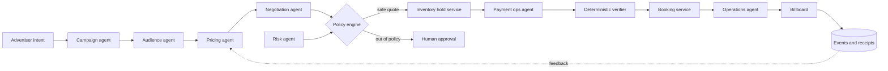

# Agent team and communication contract

**Proposed** multi-agent design. Do not confuse agent names with independently deployed LLMs; one model/orchestrator may implement several roles.

## Roles

| Role | Reads | Allowed actions | Never allowed |
|---|---|---|---|
| Campaign | advertiser brief, campaign rules | normalize intent, propose inventory filters | publish creative, spend money |
| Audience | aggregate counts, public events, time | estimate reach with confidence, cite source/time | face identification, sensitive-profile inference |
| Pricing | slot availability, counts, operator floors | propose fixed numeric quotes through pricing tool | bypass floor, confirm booking |
| Prospecting | explicitly approved public leads | draft outreach and request operator approval | uncontrolled mass emailing, access private data |
| Negotiation | buyer budget authorization, quote terms | counteroffer within policy and max rounds | unlimited spending, reserve without approval |
| Risk | permitted sandbox responses and business attributes | recommend terms/review reason | automatically label weak credit as fraud |
| Payment operations | verified payment events, expected receivables | reconcile, flag mismatch, request retry/refund approval | forge receipt or mark transaction paid |
| Booking / scheduling | confirmed booking, approved creative | publish schedule via service, capture receipt | screen content without paid booking + approval |
| Owner oversight | audit trail and risk queue | approve exceptions and policy overrides | silently erase event history |

## Orchestration diagram



## Message envelope (contract proposal)

```json
{
  "event_id": "evt_uuid",
  "trace_id": "trace_uuid",
  "type": "quote.proposed",
  "source_agent": "pricing",
  "target": "policy_engine",
  "campaign_id": "cmp_uuid",
  "causation_id": "evt_parent",
  "timestamp": "2026-10-24T20:00:00Z",
  "schema_version": 1,
  "payload": {
    "quote_id": "q_uuid",
    "slot_ids": ["slot_uuid"],
    "currency": "USD",
    "amount_minor": 12500,
    "expires_at": "2026-10-24T20:05:00Z",
    "pricing_basis": ["footfall_aggregate", "time_of_day"],
    "confidence": 0.7
  }
}
```

Required properties: schema validated, versioned, traceable, replay-safe and bounded.

## Agent tool/API permissions

Propose interface names (not yet implemented): `campaign.parseBrief`, `audience.getAggregate`, `inventory.listAvailable`, `pricing.proposeQuote`, `negotiation.counterOffer`, `policy.evaluate`, `inventory.createHold`, `payments.initiate`, `payments.verify`, `booking.confirm`, `display.schedule`, `audit.record`.

Only backend services can perform `createHold`, `verify`, `confirm` and `schedule`. Every mutation includes `idempotency_key`, `actor_id` and `trace_id`.

## Negotiation rules

- Buyers declare maximum spend and campaign constraints.
- Sellers declare minimum price, minimum delivery standards and allowed discounts.
- Limit negotiation to 3–5 rounds, with expiry and monotonic budget checks.
- Once terms are accepted generate immutable quote/version, then hold, pay, verify and book.
- No agent may infer that a chat message proves payment.

## Auditable recovery demo

Duplicate slot interest or mismatched receipts causes explicit exception. Finance agent shows *expected*, *observed*, *difference*, *source evidence* and *next bounded action*. Operator has an approval path. No quiet overwrite.
