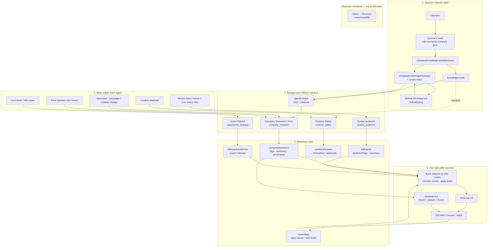

# CREAO live workflow

How the sponsor **network**, company knowledge, and background CREAO harnesses feed BillboardOS — without sitting in the 30-second sale loop.

**Background CREAO:** Company Research (price factors) · Screen Audience · Creative Safety · Invite (opportunity strategy)  
**Fast path:** Convex ranks the network, invites top 10 vibe matches, runs offers/counters/settlement  
**Not on this path:** Sales / Revenue rehearsal

## Diagram

Editable Mermaid source: [`docs/diagrams/creao-live-workflow.mmd`](../diagrams/creao-live-workflow.mmd)

## Read left to right

1. **Network** — Operator seeds the Cal Hacks company-sponsor pool (campaign + YouTube + buyer agent + research). Knowledge cards/passages are optional enrichment for CREAO context.
2. **Triggers** — Research/audience/safety wake on data changes or cron. Price harness refreshes stale `priceFactor` hourly. Invite harness wakes when someone cools down or the roster is thin.
3. **CREAO harness** — Minutes-scale. Writes tags, summaries, price factors, creative gates, and optional invite prefs. Never bids in the 30s window.
4. **Stores** — Results land in Convex tables the fast path already reads.
5. **Fast sale** — Rank full network by vibe match (`screen.audienceTags` × company tags), skip cooled companies, apply prefs, invite **top 10**, price and settle in seconds. Three consecutive price rejects → cool-down ~10 windows → next-best enters automatically.

## Design rules

- Missing CREAO env: Claude/rules fallback for research; Invite harness writes deterministic next-best prefs. Sales still run.
- Workpool + rate limiter bound CREAO/research fan-out so harness ticks cannot stampede credits.
- Sales → Revenue rehearsal stays parallel and does not feed the live invite set.
