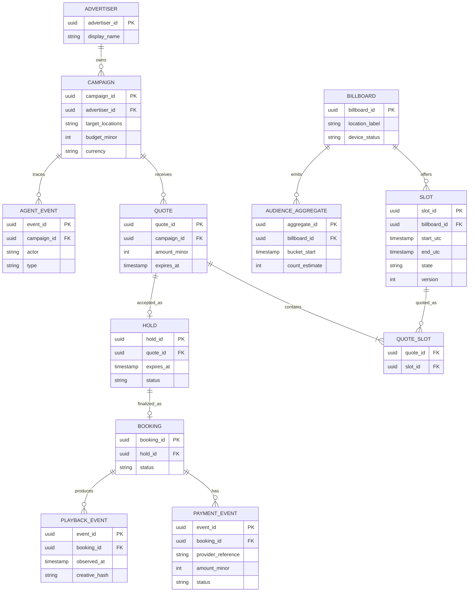

# Proposed data model and API surface

This is a logical schema, not an implemented database migration. Use UTC timestamps, explicit currency/network and integer monetary units.

**Model note:** `PAYMENT_EVENT.booking_id` must support payment-before-confirmation by initially linking to `hold_id` or a purchase intent. Final migrations should enforce this and avoid requiring a confirmed booking to store an incoming payment event.

## Suggested routes

| Method | Route | Purpose | Policy |
|---|---|---|---|
| POST | `/api/campaigns` | Create and validate advertiser campaign | authenticated advertiser |
| GET | `/api/billboards` | List location inventory | public filtered view |
| GET | `/api/slots?billboard_id=…` | Available slots | no hidden reservations |
| POST | `/api/quotes` | Deterministic quote, optional agent explanation | seller price policy |
| POST | `/api/quotes/:id/holds` | Exclusive TTL hold | atomic, idempotent |
| POST | `/api/purchases/:holdId` | Protected checkout / x402 route | quote + network + amount validation |
| POST | `/api/payments/notifications` | Provider event handling | signature + idempotency |
| POST | `/api/bookings/:id/approve-creative` | Approve assets | operator only |
| GET | `/api/dashboard` | Owner revenue/occupancy and exceptions | operator |
| POST | `/api/devices/:id/playback` | Append delivery receipts | device authentication |

## Agent event types

`brief.parsed`, `inventory.queried`, `quote.proposed`, `counteroffer.received`, `policy.evaluated`, `slot.held`, `hold.expired`, `payment.verification_requested`, `payment.confirmed`, `booking.confirmed`, `creative.approved`, `playback.observed`, `finance.exception_opened`, `operator.approved`.

## Contract test examples

- Two simultaneous holds for the same slot result in exactly one success.
- Replaying confirmed payment proof does not create a second booking.
- Incorrect currency/amount rejects payment and prevents scheduling.
- Video/creative cannot publish before approval.
- Missing sensor data falls back to baseline pricing labeled low confidence.
