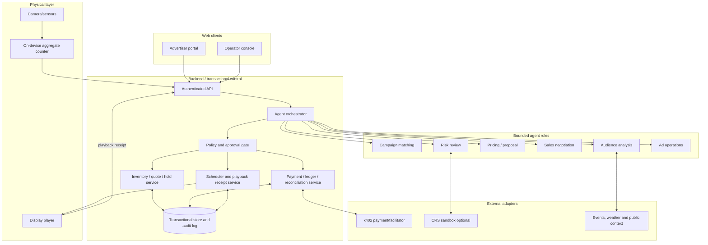
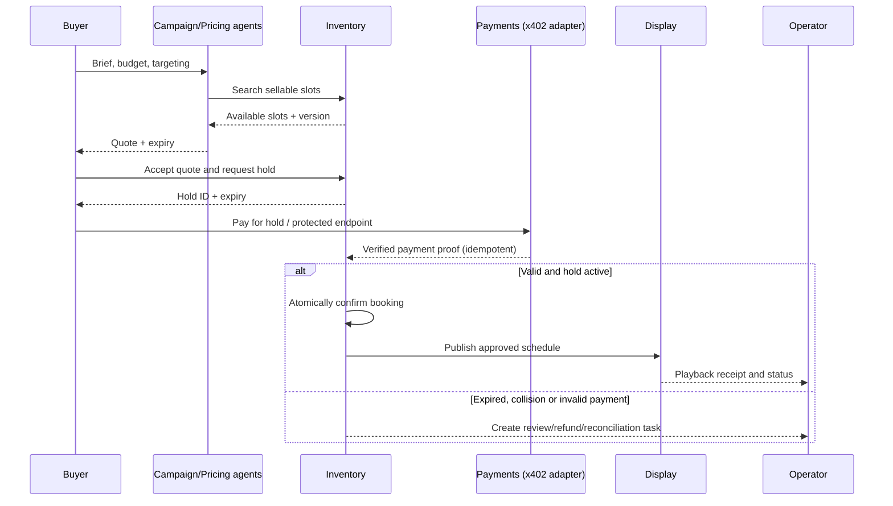

# System architecture

**Status:** Proposed architecture, not implemented. Keep execution deterministic and agent reasoning bounded.

> The logical components below map onto sponsor tools (Convex, Coinbase x402, Capital One Nessie, CRS, Claude, Fetch.ai) in [ADR 0002](../decisions/0002-sponsor-native-stack.md).

## Component map

## Why split agents from services?

Agents may **propose** quotes, ask for evidence and choose next actions. They must not directly mutate inventory or declare payments settled. Deterministic services enforce price floors, timestamps, role permissions, uniqueness constraints, approval policy and payment proof. This is the auditable autonomy Hyphenate-style judging asks for.

## Critical sequence

## Deployment boundaries

- **Browser:** campaign brief, quotes, negotiation UI, owner approvals and audit timeline.
- **Server:** authentication, API contracts, state transitions, wallet/payment verification and policy execution.
- **Database:** single source of truth for slots, holds, bookings, payment attempts, journal, creative assets and events.
- **Edge:** sensor aggregator and scheduled ad player. Process images locally when feasible.
- **External adapters:** sponsor APIs separately deployable/configurable, using mocks only in labeled development modes.

## Failure scenarios

- **Double claim:** unique/serialized hold per timeslot; buyer two sees unavailability.
- **Payment replay:** check chain/receipt/facilitator result, nonce/idempotency and amount/currency.
- **Expired hold after payment:** record exception; never silently book a different slot or discard funds.
- **CRS unavailable:** policy routes to manual review rather than inventing clearance.
- **Screen offline:** queue intended schedule, mark delivery unverified, report issue.
- **LLM hallucination:** quote numbers come from validated deterministic pricing function, not free-form text.

See [agents](agents.md), [payments/risk](payments-and-risk.md), [data model](data-model.md) and [requirements](../product/requirements.md).
