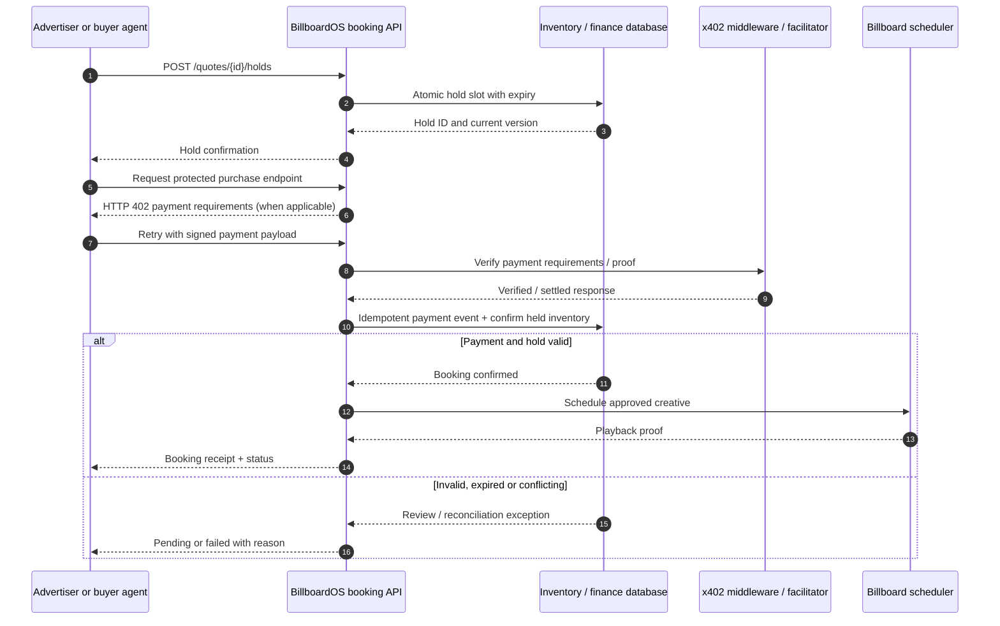
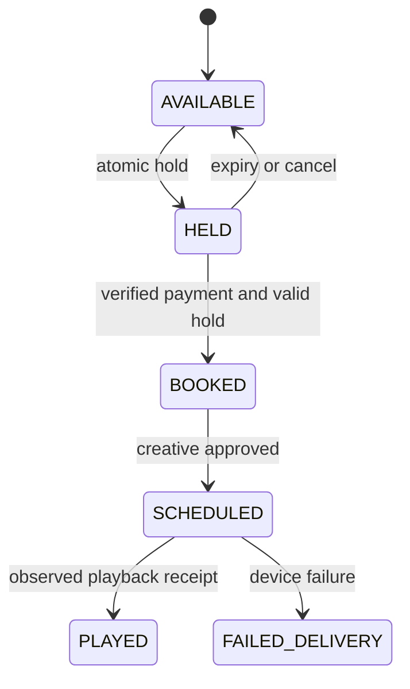
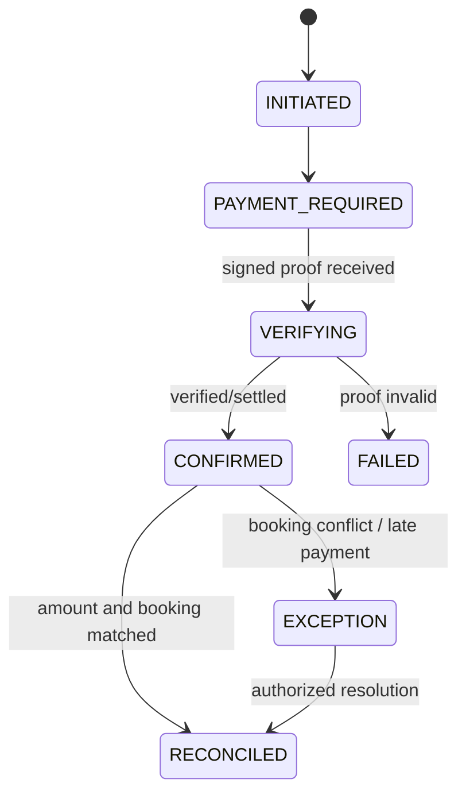
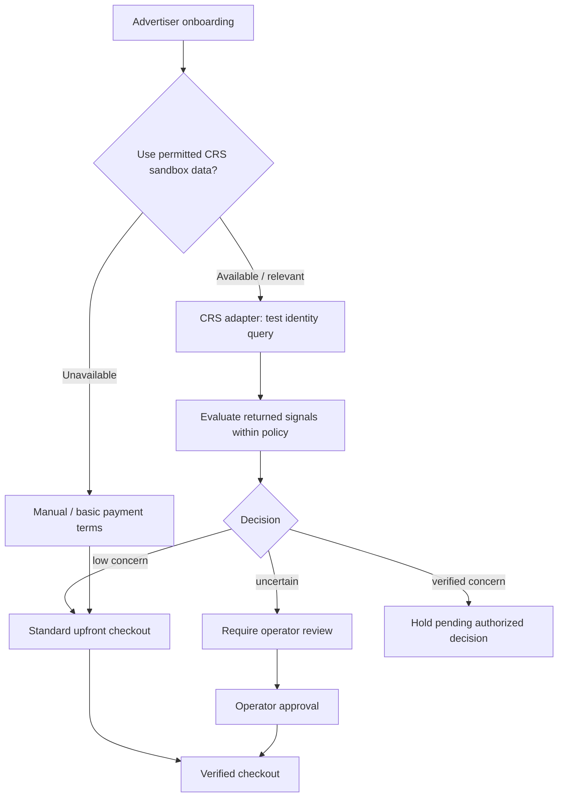

# Payments, booking and risk controls

**Implementation design proposal.** The exact Coinbase x402 sponsor setup, CRS product capabilities, chains, supported currencies and endpoints must be checked against official sponsor documentation. This document describes responsibilities, **not a verified integration**.

## Payment and slot booking (logical flow)

**Important x402 distinction:** In a typical x402 exchange, the **resource server** announces payment terms (HTTP 402); a compatible **client** supplies a signed payment payload and retries; the **server** verifies/settles via a facilitator or chain-supporting implementation. Exact header names, settlement semantics and SDK behavior depend on the version adopted. Coinbase/x402 does **not** implement business negotiation or quote matching for us.

## State machines

### Inventory

### Payment

## Ledger and exception conditions

Record an append-only payment journal: `event_id`, `booking_id`, `quote_id`, `hold_id`, `external_payment_id`, `status`, `amount_minor`, `asset/currency`, `observed_at`, `idempotency_key`, `evidence_pointer`. Track **expected revenue** separately from **collected cash**; do not treat invoice creation as payment settlement.

A refund (if applicable) is a separate, authorized compensating transaction. Payment succeeded after hold expiry = exception, never quietly ignore. Duplicate webhook = one outcome. Price mismatch = manual review.

## Risk/CRS boundary

Never use credit score alone as proof of fraud. Never submit real identities to a hackathon sandbox. A CRS category named 'business verification' is **not confirmed** as an available endpoint for this team.

## Security requirements

- Keys in environment/secrets manager, not browser or Git.
- Session-authenticated booking API, quote expiry, typed amounts, currency and network.
- Amounts in smallest units (integer) and reconciliation after confirmation.
- Human approvals for credit-policy exceptions, unverified creative and nonstandard refunds.
- No raw face storage by default; handle payment metadata according to provider docs.
