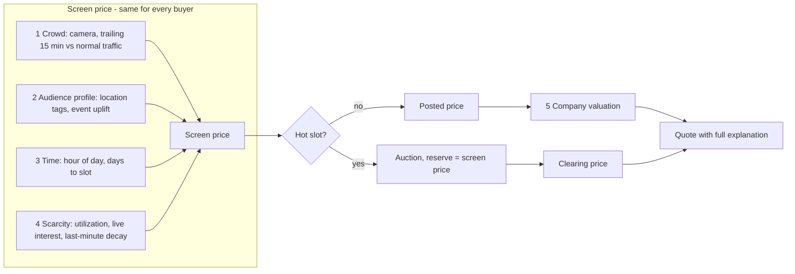
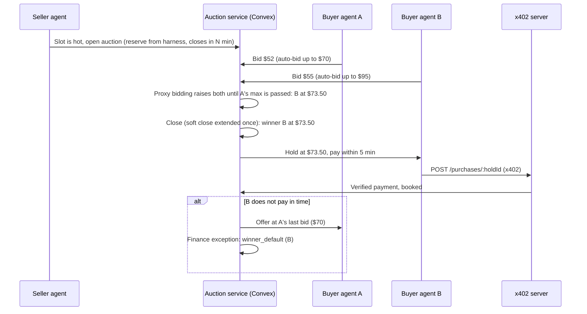

# ADR 0003 — Pricing harness and agentic bidding

**Date:** 2026-10-24  
**Status:** Accepted 2026-10-24 (team chose: ascending live auction; hidden LLM-assessed company pricing; full Phase A)  
**Builds on:** [ADR 0002](0002-sponsor-native-stack.md), `convex/lib/pricing.ts` (base × multipliers, reserve floor, written basis per factor)

## Context

Today a quote is `base rate × audience demand × hour of day`, never below the reserve floor. The team's pricing idea has five more inputs:

1. **Crowd (vision).** How many people pass the screen, from a pretrained model on a camera. *Built:* on-device MediaPipe person detection, trailing 15-minute window.
2. **Who is likely there (location).** A screen near Moscone in San Francisco reaches software people; one in lower Manhattan reaches finance people. Later: read nearby events and reason about who they draw.
3. **Scarcity and timing.** A free, unwanted slot should get cheaper as it approaches; a prime slot several buyers want should not be sold at a posted price at all. They should bid.
4. **Who is buying.** A well-known brand (Nvidia) gets more value from the same screen than an unknown startup, and the original idea already promised startups discounted packages.
5. **Learning later.** Every stage can become a real ML model (demand forecast, audience mix, price elasticity) without changing the structure.

The invariant from ADR 0002 stays: **agents propose, deterministic code commits.** No LLM decides a price, a winner or a payment.

## Decision

### 1. A staged pricing harness

Each stage is a pure function returning `{ multiplier, confidence, explanation }`. The combiner multiplies confidence-weighted multipliers, clamps to `[reserve floor, ceiling]`, and stores every stage's explanation on the quote, so any price can be explained line by line (Hyphenate: "explainable and accountable").

| Stage | Inputs | Output | Now (hackathon) | Later (ML) |
|---|---|---|---|---|
| 1 Crowd | Camera arrivals, per-screen normal traffic | Demand ×0.8 to ×2.0 | **Built** | Footfall forecast per slot, not just the last 15 minutes |
| 2 Audience profile | Screen's location tags (e.g. SF Moscone: software 0.6, startups 0.2, tourists 0.2); nearby events | Event uplift ×1.0 to ×1.5; profile used for matching (below) | Seeded tags per screen; seeded event list; Claude classifies an event's audience and expected size once, output validated and clamped | Learned audience mix from public data; event attendance model |
| 3 Time | Hour, weekday, days until slot | ×0.6 to ×1.3 | Hour factor **built**; add weekday | Seasonal demand curve per screen |
| 4 Scarcity | Share of nearby slots sold, active quotes and holds on this slot, minutes until start | Surge up to ×1.5; last-minute decay down to the floor | New | Price elasticity model (yield management) |
| 5 Company valuation | Public research (Claude + web search), the company's submission, its history with us, market price history, CRS business credit | Willingness-to-pay ×0.75 to ×1.5, clamped, cached 24 h | Claude research action with a deterministic fallback when no key; operator override | Learned willingness-to-pay model |

**Audience match is for matching and bidding, not for the posted price.** A finance brand looking at the SF Moscone screen sees the same screen price as a software brand. The match score (campaign target audience against screen tags) is used to recommend screens and to compute what a buyer agent should bid. That keeps the posted price fair and explainable, and lets the market express how much each buyer values the audience.

### 2. Company-specific pricing, assessed by an LLM (decided)

The team chose a **per-company price that the buyer doesn't see**, reasoned by an LLM over everything we know about the company, instead of three published tiers.

**The company valuation harness** (a "pricing analyst" agent) assesses each advertiser and produces a willingness-to-pay multiplier:

| Input | Source |
|---|---|
| Public research | Claude with the web search tool: brand recognition, size, funding, recent news, ad spend signals |
| Their submission | The campaign brief, budget, target cities and creative they uploaded |
| Interaction history | Their past quotes, holds, bookings, negotiation outcomes, payment behaviour (late payers, disputes) |
| Price history across the system | Recent clearing prices and accepted quotes for similar slots, and how this company's past acceptance compared to the market |
| Business credit (when keys arrive) | CRS business credit report |

**Output** (structured JSON, validated): `multiplier`, `brandTier` (label for operators), `reasoning`, `sources` (URLs it cited), `confidence`, `model`, `assessedAt`.

**Guardrails that keep it defensible:**
- **Bounded:** the multiplier is clamped to ×0.75 to ×1.5 by code, whatever the model says, and the final price is still clamped to the screen's floor and ceiling.
- **Stable:** an assessment is cached per company for 24 hours (or until the operator re-runs it), so a buyer's price doesn't change between two quotes in the same conversation.
- **Hidden from the buyer, never hidden from us:** the quote the buyer sees shows the screen price explanation and the final price. The operator console and the audit log show the company multiplier, its reasoning and cited sources. Hyphenate's "explainable when someone asks" is met internally.
- **Business signals only:** inputs are about companies, never about individual people, and nothing the camera sees is used.
- **Fallback without a key:** if Claude is unavailable, a deterministic heuristic (declared company size, budget, booking and payment history) runs instead, labeled `heuristic` with low confidence.
- **Operator override:** an operator can pin a company's multiplier; overrides are audited.
- **Posted prices only:** the company multiplier applies to posted (non-auction) quotes. In auctions every bidder faces the same reserve; the bidding itself reveals what the slot is worth to each buyer.

### 3. Hot slots go to auction

A slot is **hot** when any of these is true: two or more distinct buyers quote or hold it within 10 minutes; the trailing crowd is at least 1.5× normal; an event uplift applies. Hot slots stop selling at the posted price and open an auction.

**Format: ascending live auction with proxy bidding** (decided).

- Opens at the reserve (the screen price from the harness). Bids are public and must beat the current price by a minimum increment (5%, at least $1).
- Each buyer agent may also set a private **auto-bid maximum**; the system raises its bid by the increment whenever it is outbid, up to that maximum. Agents can raise their maximum while the auction runs, after reasoning about the competition.
- **Soft close:** a bid in the final 30 seconds extends the auction by 30 seconds, so nobody wins by sniping. A hard cap (e.g. 3 extra minutes) keeps the demo bounded.
- The highest bidder at close wins at their current bid. Ties go to the earliest bid.
- The console and the booking page show the live bid ladder (amounts, anonymized bidder labels, time left).

**Auction lifecycle**, reusing the holds and payments we already have:

- Every bid, the clearing calculation and the winner are audit events.
- The seller (operator or seller agent) cannot bid on its own auction.
- A buyer's bid can never exceed the budget authorization on its campaign.
- Clearing is deterministic code on a Convex schedule. It holds even if every agent is offline.

### 4. The agents

| Agent | Decides (proposes) | Bounded by |
|---|---|---|
| **Seller agent** | Which slots to auction, auction length, packages for cold slots, last-minute discount offers to matching advertisers | Harness price is the reserve; floor and ceiling; operator approval for discounts beyond policy |
| **Buyer agent** (one per advertiser) | Its valuation, opening bid, auto-bid maximum, and whether to raise it mid-auction: expected audience × audience match × value per relevant viewer, paced against remaining budget | Campaign budget cap, max bid per slot, spend limits in its x402 wallet |
| **Company analyst** | Each advertiser's willingness-to-pay multiplier from research, submission, history and market prices | Clamped ×0.75–×1.5, cached 24 h, operator override, audited |
| **Pricing analyst** | Event interpretation ("Dreamforce at Moscone: ~40k, mostly software and sales; uplift ×1.4") | Output is validated and clamped; a person can override; cached so the price doesn't change on every call |

The LLM writes the reasoning, and code computes or bounds the number. For example, the buyer agent's auto-bid maximum is `min(valuation, maxBid, remainingBudget)`, and the company multiplier is clamped before use.

## Sponsor fit

| Piece | Sponsor | Why it's meaningful |
|---|---|---|
| Live auction board, scheduled close, atomic clearing | **Convex** | Real-time shared state between competing agents is exactly what the Convex track asks for |
| Buyer agents paying the clearing price | **Coinbase Payment Agents** | "An agent that buys", "hires another agent", "manages the budget for a small business" |
| Customer tier from business credit | **CRS** | CRS data changes the price and the terms, not just a badge |
| Event reasoning, valuation explanations | **Anthropic (Claude)** | Claude does the judgment; code keeps it bounded |
| Buyer agents living on Agentverse | **Fetch.ai** (P2) | Multi-agent bidding is one of their bonus criteria |
| Winner default, refunds, reserve audits | **Hyphenate** | Another "moment": a winner who doesn't pay, caught and handed to the runner-up with an audit trail |
| Seller-side prospecting for cold slots | **CREAO** | The prospector offers last-minute discounts to matching advertisers |

## Build plan

**Phase A, demo-critical (about 4 hours):**
1. Refactor `lib/pricing.ts` into the stage list plus combiner. No behaviour change; existing tests must pass.
2. Screen audience tags; campaign target audience; match score used in screen recommendations.
3. Scarcity stage (utilization, live interest, last-minute decay).
4. Company valuation harness: assessment table, Claude research action (web search, structured output), deterministic heuristic fallback, cache, operator override; applied to posted prices; reasoning visible in the console only.
4b. Market history stage: recent accepted prices for similar slots as an anchor.
5. Auctions: `auctions` and `bids` tables, open, bid and auto-bid mutations, soft close on a schedule, winner hold, runner-up fallback, `winner_default` exception. Tests for increments, proxy bidding, soft close, ties, reserve, default.
6. Live auction panel in the console and on the booking page; a buyer CLI that runs two competing agents with different valuations.

**Phase B, with keys:** Claude event reasoning and bid explanations; CRS-driven tiers; agents paying through x402; Fetch.ai buyer agents.

## Consequences

**Pros:** One explainable structure for every pricing idea, each stage replaceable by a real model later. Auctions turn "guess what Nvidia will pay" into "let Nvidia's agent tell us". Several sponsor tracks get deeper rather than wider.

**Cons:** More moving parts in a 2-minute demo; auctions need two live buyers to look interesting (we script two agents). Tiered pricing must be disclosed clearly or it looks unfair.

## Open questions

- Auction length for the demo (2–3 minutes) versus real life (closes 30 minutes before the slot)?
- Who may see the company multiplier: operator only, or also the advertiser's own account manager view later?
