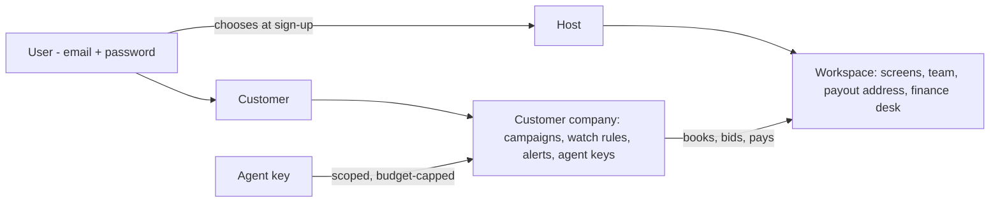

# ADR 0004 — Two-sided marketplace: host workspaces and customer accounts

**Date:** 2026-10-24  
**Status:** Accepted (team chose: sign-in + agent keys; in-app alerts + agent webhook; self-serve host workspaces)  
**Builds on:** [ADR 0002](0002-sponsor-native-stack.md), [ADR 0003](0003-pricing-harness-and-bidding.md). Prepares the agent-to-agent x402 payment step.

## Context

Today there is one kind of signed-in user, the operator (first account wins), and booking is public. BillboardOS should be a marketplace with two sides:

- **Hosts** own LCD screens or monitors. They run a workspace: screens, pricing, approvals, money.
- **Customers** run marketing campaigns. They book spots ahead of time, or ask to be told when a spot that fits them opens up, and they can let their own buying agent act for them.

## Decision

### Accounts and tenancy

| Concept | What it is |
|---|---|
| **User** | A Convex Auth account. Chooses **Host** or **Customer** at sign-up. |
| **Workspace** (host side) | Owns billboards, slots, quotes for its screens, holds, bookings, invoices, bank feed, approvals, auctions, audit. Has members (`owner`, `operator`) and an x402 **payout address**. Self-serve: a host signs up, names the workspace, adds screens, invites teammates by email. |
| **Customer company** (the existing `advertisers` table, extended) | Owns campaigns, creatives, watch rules, alerts and agent keys. Has members. A customer signs up and creates their company (name, website, size). |
| **Agent key** | Issued by a customer from their dashboard: name, scopes (`quote`, `hold`, `bid`, `pay`), allowed campaigns, budget cap, expiry, optional webhook URL. Shown once, stored hashed, revocable. |

**Isolation rules**
- A workspace member sees only that workspace's screens, money, approvals and audit trail. Every host function checks membership of the workspace that owns the record.
- Customers see the whole marketplace inventory (all hosts' screens and live prices), but only their own campaigns, quotes, holds, bookings, invoices and alerts.
- Separation of duties stays per workspace: requester ≠ approver; agents never approve.
- Company valuation (ADR 0003) stays platform-level; overrides are per workspace and audited.
- The billboard player stays public by screen ID. The audience sensor requires a member of the screen's workspace.

**x402 payouts go to the host.** Each workspace sets its own payout address. The x402 server looks up the hold's workspace and charges to that address (falling back to `X402_PAY_TO` for the seeded workspace). This is what makes the next step real agent-to-agent commerce: a customer's agent pays the host's agent.

### Booking ahead

Customers book through the existing quote → hold → pay flow, now as themselves. Their buying agent does the same with an agent key over an HTTP API:

| Endpoint (Convex HTTP, `Authorization: Bearer <agent key>`) | Scope |
|---|---|
| `GET /api/agent/inventory` (recommended screens and upcoming slots with screen prices) | any |
| `POST /api/agent/quotes` | `quote` |
| `POST /api/agent/holds` | `hold` |
| `POST /api/agent/auctions/{id}/join`, `/bid`, `/auto-bid`; `GET .../status` | `bid` |
| `GET /api/agent/alerts` | any |
| Payment: existing x402 server, `POST /purchases/{holdId}` | `pay` (key checked against the hold's company) |

Every agent call is audited with the key's name (`agent:<company>/<key name>`), checked against its allowed campaigns and its budget cap (total committed in active holds and bookings).

### "Tell me when a spot fits"

Customers save **watch rules** on a campaign:

| Field | Example |
|---|---|
| Where | Cities, specific screens, or "any screen with audience match ≥ 60%" |
| When | Days of week, hours, date range |
| Price | Maximum price per 15 minutes |
| Triggers | `available` (a fitting slot is on sale), `price_drop` (now under my max), `last_minute` (discounted because it starts soon), `auction_open` |
| Delivery | `inbox` (live in the app), `agent` (signed webhook to the key's URL) |

A deterministic **matcher** creates **alerts**:
- **Event-driven:** when slots are created, a hold is released or expires, an auction opens, or a last-minute discount begins.
- **Sweep:** a cron every 5 minutes re-checks upcoming available slots against active rules (bounded), so price changes from crowd and events are caught.
- **Deduplicated** per rule, slot and trigger, so a customer isn't spammed.

Alerts appear live in the customer's inbox. For `agent` delivery, an action POSTs a JSON alert signed with HMAC-SHA256 (header `X-BillboardOS-Signature`) to the agent's webhook, retries with backoff, and records delivery status. The agent can then quote, hold, bid or pay through the API above. That's the hand-off into agent-to-agent payments.

## Migration

- Everything that exists today moves into a seeded **"Moscone Media"** workspace (the Moscone West screen, slots, finance fixtures, auctions, payments, audit).
- Existing operator accounts become owners of Moscone Media. The "first account becomes operator" rule is removed.
- Existing advertisers (Golden Gate Coffee, Nvidia, the finance fixture companies) become customer companies with no members yet. A `seed.demoAccounts` CLI step creates agent keys for the demo buyer agents and prints them once.
- Schema changes are additive (`workspaceId` optional first, backfilled, then required) per Convex migration rules.

## Build plan

1. **Accounts and tenancy:** account type at sign-up, workspaces and members, customer companies and members, workspace scoping on every host function and query, customer scoping on campaigns, quotes, holds, bids and bookings, migration and backfill, tests for isolation (host A can't see host B; customer A can't see customer B).
2. **Agent keys and the agent HTTP API:** key issue/revoke, scopes, budget cap, audit; update `buyer-agent.ts` and `auction-agents.ts` to use keys; x402 server pays out to the hold's workspace and checks the `pay` scope.
3. **Watch rules and alerts:** rules CRUD, matcher (events + sweep), dedupe, live inbox, signed webhook delivery with retries.
4. **UI:** sign-up with role choice; host workspace (screens, team, payout address) around the existing console, finance and sensor; customer dashboard (campaigns, book, watch rules, alerts inbox, agent keys, my bookings and invoices).

Then: agent-to-agent payments over x402 (next ADR).

## Consequences

**Pros:** A real marketplace story for Microsoft (customer understanding), CREAO (a one-person host company), Coinbase (customer agents paying host agents), Convex (multi-tenant real-time). Watch rules turn unsold inventory into demand automatically.

**Cons:** Touches nearly every function; isolation bugs are the main risk, so isolation gets explicit tests. Demo setup needs a host login and customer logins.
