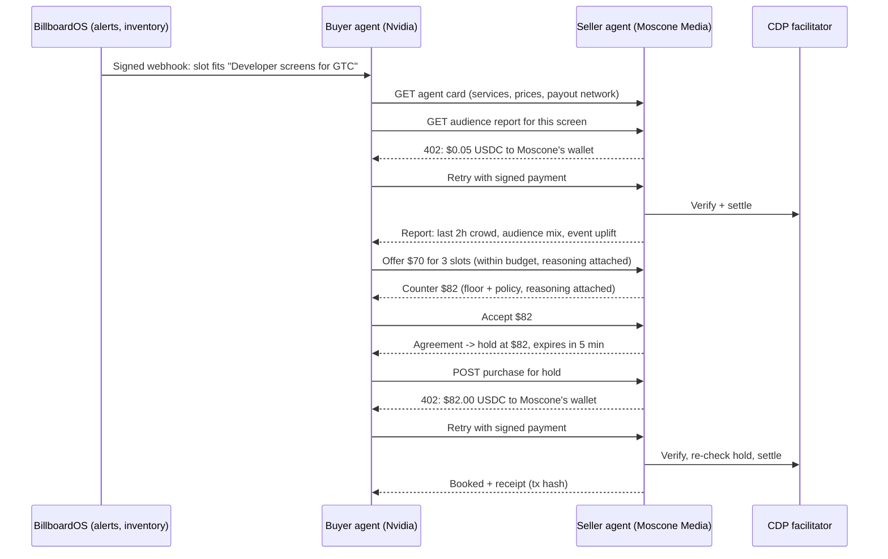

# ADR 0005 — Agent-to-agent commerce over x402

**Date:** 2026-10-24  
**Status:** Proposed  
**Builds on:** [ADR 0003](0003-pricing-harness-and-bidding.md) (pricing, auctions), [ADR 0004](0004-two-sided-marketplace.md) (workspaces, agent keys, alerts), [Coinbase track](../sponsors/coinbase-x402.md) (Payment Agents)

## Context

Today a customer's buying agent calls the BillboardOS API and pays for a hold over x402; the money lands in the host's payout address. That is an agent paying a platform. The Coinbase Payment Agents track rewards agents that **buy tools or services, sell a service, hire another agent, or manage a small business's budget**. Our two sides already map to that: every host workspace is a small business selling screen time, and every customer runs a budget.

## Decision

Each host workspace gets a **seller agent**. Each customer can run a **buyer agent** (with an agent key and its own CDP wallet). They talk to each other over HTTP, and every payment between them is x402, paid to the host's wallet.

### 1. The seller agent's services

Each workspace's seller agent is served by the x402 server at `/a2a/hosts/{workspaceId}/…`:

| Endpoint | Paid? | What it does |
|---|---|---|
| `GET agent.json` | Free | **Agent card**: who the host is, screens, services, prices, payout network and address, negotiation policy summary (max rounds, offer validity) |
| `GET reports/audience?billboardId=` | **x402, $0.05** | Pay-per-call data product: trailing crowd, peak in view, audience mix tags, upcoming events, recent clearing prices. The buyer agent buys it before deciding how much to bid. This is "an agent that sells research" |
| `POST negotiations` and `POST negotiations/{id}/messages` | Free (agent key) | Offer / counter / accept / reject on specific slots |
| `POST purchases/{holdId}` | **x402, hold amount** | Pay for the agreed hold; payout to the workspace's address |

All four also appear in the x402 Bazaar extension the CDP server already adds, so outside agents can discover them.

### 2. Negotiation protocol

- Messages: `offer {slotIds, amountMinor, reasoning}`, `counter {amountMinor, reasoning}`, `accept`, `reject {reason}`. Every message is stored, audited, and visible to both parties' humans.
- **Rounds:** at most 4. Each offer is valid for 2 minutes. Slots are not held during negotiation; an `accept` creates the quote and hold atomically, and fails cleanly if the slots sold meanwhile.
- **Seller policy (deterministic):** never below the screen price × the workspace's negotiation floor (default 0.9, per workspace), never below the reserve floor. Concessions shrink each round. Uses the company valuation (ADR 0003) as the opening ask. Hot slots (an auction is open) refuse negotiation and point to the auction.
- **Buyer policy (deterministic, in the buyer script):** opening offer from its valuation × 0.75, never above `min(valuation, key budget left)`, concedes toward its maximum.
- **Claude writes the reasoning text** on both sides when `ANTHROPIC_API_KEY` is set; code decides every number.

### 3. The demo loop

`npm run a2a:demo` runs the whole conversation for Nvidia against Moscone Media:
1. It's triggered by a watch-rule alert, either a real webhook or the agent API's `GET alerts`.
2. The buyer reads the seller's agent card and buys the audience report: the first x402 payment, $0.05.
3. It negotiates over two or three rounds, then pays for the hold: the second x402 payment.

It prints each message, each payment and its Basescan link. The console and the customer dashboard show the same conversation as a timeline, with payments marked.

Without `CDP_WALLET_SECRET` and test USDC, the demo runs every step up to each 402 challenge and says so. Nothing is faked as paid.

### 4. Fixes carried into this step

- **Webhook signature covers the timestamp.** Sign `"<timestamp>.<raw body>"` instead of the body alone, so a captured alert can't be replayed later with a fresh timestamp. The receiver checks both.
- **Demo watch rules default to inbox-only** when no public webhook URL is given, so the cron doesn't create deliveries that fail forever.

## Sponsor fit

- **Coinbase Payment Agents:** both agents participate in commerce. One sells data and screen time; the other buys a tool (data) to finish a job and manages a campaign budget. Two kinds of x402 payment run between them, discoverable through the Bazaar.
- **Hyphenate:** every agent message and payment lands in the host's ledger and audit trail. Report revenue is a new receivable line.
- **Fetch.ai (later):** the seller agent's card and negotiation endpoints map onto an Agentverse agent with the Chat Protocol.

## Consequences

**Pros:** A concrete agent-to-agent economy with real x402 settlement, not one agent paying a checkout page. Every decision stays bounded and auditable.

**Cons:** More endpoints in the x402 server. A real demo needs two funded test wallets (buyer pays; seller only receives).
