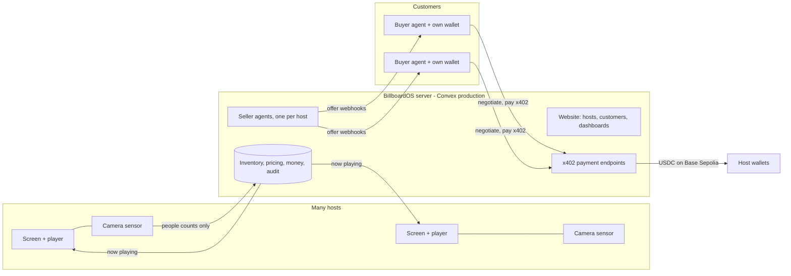

# ADR 0006 — The live moment: from crowd to paid playback in under 30 seconds

**Date:** 2026-10-24  
**Status:** Accepted (team vision)  
**Builds on:** ADRs [0003](0003-pricing-harness-and-bidding.md) (pricing, auctions), [0004](0004-two-sided-marketplace.md) (hosts, customers, alerts), [0005](0005-agent-to-agent-x402.md) (agent-to-agent x402)

## The story

> A screen on a San Francisco street normally sees about 15 people every 15 minutes. Today a startup demo day is running next door. The camera now counts about 30 people. The host's seller agent notices: *30 people, and the event draws founders and engineers.* It looks through the customers already on BillboardOS, finds the ones whose campaigns target startups and that have a ready-to-play video, and sends their agents an offer for the next few minutes of screen time. Their agents weigh it, one counters, the seller accepts, the winner pays over x402, and the ad starts playing on the screen. **Under 30 seconds from the crowd forming to the ad on screen, with no human in the loop**, and every step on the dashboard.

## How it runs in real life

- **One OS server.** Convex production hosts the database, server functions, the website, and the x402 payment endpoints. The separate Express server is retired, or kept only for local tests. One public URL for everyone: the team, judges, and agents.
- **Hosts** sign up, add screens, open the player URL on the screen and the sensor URL on a laptop or camera next to it, and set their payout wallet.
- **Customers** sign up, create campaigns with target audiences, upload and get approval for a creative, and connect a buyer agent: their own service with their own wallet, an agent key and a webhook. They set **standing instructions**: "Spend up to $X per spot when at least N people who match my audience are watching."
- **Money:** test USDC on Base Sepolia. Buyers pay from their own wallets to the host's wallet. The platform never holds customer funds (Coinbase rule: don't manage funds for other people).

## The pipeline, and its time budget

| Step | What happens | Target |
|---|---|---|
| 1. Sense | The sensor sends arrivals every 5 s during a moment (10 s otherwise). The trailing window and event stage update | ~5 s |
| 2. Detect | The seller agent's **moment detector** fires when relevant audience (crowd × event and screen audience match) crosses the host's threshold. Example: "30 people, startup event ×1.3, 70% startup audience → about 21 relevant viewers" | < 1 s |
| 3. Target | Picks customers from the database: active campaign whose target audience matches, an **approved, ready-to-play creative** for this host, a connected agent with standing instructions that cover the price | < 1 s |
| 4. Offer | Creates a **flash offer** for the next spot (the next 5 minutes, or the rest of the current slot), priced by the harness. Sends a signed webhook to each targeted agent and posts to their inbox | ~1–2 s |
| 5. Decide | Agents reply within an **8-second window**: accept, counter, or pass. One accept → negotiate if they countered (at most 2 fast rounds). Several accepts → highest offer wins (a sealed, single-round flash auction) | ≤ 10 s |
| 6. Pay | The winner pays over x402 to the host's wallet: verify, re-check the hold, settle on Base Sepolia | ~3–8 s |
| 7. Play | The booking is scheduled; the player sees it through a live query and starts the pre-loaded video; a playback receipt is logged | ~1–2 s |
| **Total** | | **< 30 s** |

Every step writes a timestamped event to a **moment timeline**, so the dashboard can show a stopwatch.

## What has to be added

1. **One OS server on Convex production**
   - Move the x402 routes into Convex: HTTP actions plus a `"use node"` action that calls the CDP facilitator for verify and settle.
   - Serve the website from Convex hosting; set up production auth keys.
   - Teammates and judges use the public URL; developers keep personal dev deployments for experiments.
2. **Spots that can start now.**
   - A **flash spot**: the next N minutes (default 5), or the rest of the current slot, priced pro rata.
   - It needs an approved creative already on file, so the player can start as soon as payment settles.
3. **Ready-to-play creatives per host.** A host approves a customer's creative once; it's then "ready" on that host's screens. The player preloads ready creatives for the next likely spots.
4. **Moment detector and targeting** (seller agent): thresholds per host, the customer-matching query, flash offers and the response window, all recorded and audited.
5. **Standing instructions** on buyer agents: max price per spot, minimum relevant viewers, budget per day, auto-accept / counter policy. Used by hosted demo agents and exposed to external agents through the offer payload.
6. **Demo customer agents, hosted next to the OS but logically external.**
   - Three or four customers (a startup tool, Nvidia, Golden Gate Coffee) receive real signed webhooks over HTTP, reply over the agent API, and pay over real x402 from **our own** test wallets.
   - They're labeled "simulated customer agents" everywhere.
   - They exist so the demo doesn't depend on a laptop being awake.
7. **The moment dashboard.**
   - Host view: the screen's location, normal traffic, today's event, the camera count right now, the seller agent's reasoning, offers sent, replies, the winning price, the payment link, "now playing", and the stopwatch.
   - Customer view: "Your agent bought 5 minutes at Moscone West for $X: 21 relevant viewers."

## Honesty rules for the demo

- **Camera:** counts are real when the camera runs. The "simulate crowd" button is labeled simulated.
- **Events:** the event (e.g. "Startup Demo Day") is seeded and labeled.
- **Agents:** the demo customer agents are ours, labeled as simulated customers. They still use real webhooks, real agent keys and real x402 settlement on testnet.
- **Payments:** a payment is shown as paid only with a settlement transaction hash.

## Consequences

**Pros:** A single memorable moment that exercises every sponsor piece at once: Convex for the real-time OS, x402 for agent-to-agent payments, Hyphenate for audited money, Claude for the reasoning text, Microsoft for a production path. And it's an honest picture of how the product would run.

**Cons:**
- More moving parts on the critical path. Mitigations: a rehearsal reset; timing logged at every step; a fallback to inbox-plus-manual acceptance if an agent misses the window.
- Testnet settlement time varies. The 30-second target has ~10 s of slack.
