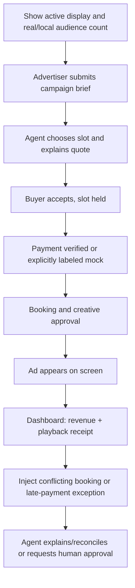

# Live judging and demo

The official Hacker Guide requires a live demonstration, recommends ~2 minutes, and says judges will be at assigned tables **Sunday 10:30 AM–12:30 PM**, after Devpost submission **by 9:00 AM** (printed pp. 7–8).

## Demo storyline — operator runs a billboard business

## Approximate 2-minute script

- **0–15s:** 'This screen is a billboard, the camera senses nearby traffic, and one operator runs the network.'
- **15–40s:** Upload a new business campaign: location, audience goal and budget. Show grounded recommendation and deterministic price.
- **40–70s:** Agent reaches an agreement and creates a temporary inventory hold. Complete a verified payment, or disclose mock checkout clearly.
- **70–95s:** Booking status becomes confirmed, screen changes to paid creative, receipt appears.
- **95–120s:** Inject duplicate offer or mismatched payment. Finance agent catches it, prevents bad booking, produces evidence and escalation path.

## 'The moment' for Hyphenate

Two buyers simultaneously attempt to buy the same Saturday screen slot. Booking agent prevents a second confirmed sale; finance agent discovers a payment whose hold expired; owner reviews a clear exception with amount, source evidence and safe resolution. Judges see a team doing **real work**, not chatting about work.

## Exhibit board: real vs simulated

| Component | Current documentation-stage status | Before submitting |
|---|---|---|
| Original competition guide | Real uploaded source | Keep exact original reference |
| Camera people count | Not yet built | Mark actual or simulated in demo |
| Quotes and booking | Designed | Demonstrate implemented state transitions |
| Coinbase x402 | Proposed | Demonstrate actual exchange and verification to claim integration |
| CRS | Proposed | Demonstrate genuine sandbox response to claim integration |
| Agent reasoning | Specified | Show actual tool trace |
| Screen playback | Proposed | Demonstrate live target device |

## Final checklist

- [ ] Devpost entry and team members added.
- [ ] Project implementation began during event, consistent with official rules.
- [ ] Clear README with setup, real integrations, limitations and safety.
- [ ] No keys in repository or screen capture.
- [ ] Venue/network failsafe and reproducible local demo.
- [ ] Every sponsor claimed has evidence.
- [ ] Team stays at judging table for full window.
