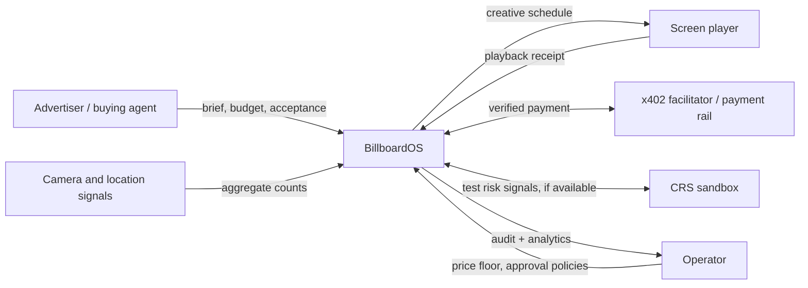

# BillboardOS — product vision

**One line:** An operating system that turns a network of digital billboards into an autonomous advertising business.

## Problem

Digital out-of-home advertising has physical inventory (screens, timeslots) but sales, audience estimation, quoting, booking, payment collection and proof of playback are fragmented and labor-intensive. A small operator cannot constantly optimize all screens and chase every customer.

## Users

1. **Operator / media owner** — wants booked revenue, cash reconciliation, trustworthy audits and control over pricing.
2. **Advertiser / agency** — wants to find appropriate locations, understand reach, buy inventory and verify delivery.
3. **Advertiser buying agent (optional)** — acts within an advertiser's explicit budget and authorization.

## Six core capabilities in the original written brief

1. Sense audience/location context through camera/sensors and external context, **without inferring jobs from faces**.
2. Dynamically price slots based on demand, expected reach, location, time and events.
3. Package inventory for different advertiser budgets and campaign outcomes.
4. Parse advertiser campaign briefs and recommend suitable locations/times.
5. Prospect for advertisers and manage proposals, negotiation and follow-up.
6. Manage bookings, financial operations, ad scheduling, delivery proof and owner dashboards.

## Platform boundaries

## MVP story

At the booth, a camera watches a small area; a monitor represents a billboard. A judge supplies an advertiser brief; the system recommends a screen/time slot, calculates a price, accepts a booking through a controlled checkout path, and plays the submitted creative on the screen. The owner dashboard shows remaining inventory, revenue and a playback receipt.

The fully autonomous prospecting and bilateral buyer/seller agent scenario are **extensions**, not blockers for a reliable first demo.

## Non-goals for the hackathon

- Identifying people, determining their profession, collecting faces or tracking individuals.
- Guaranteeing actual footfall-to-impression or sales conversion accuracy without ground truth.
- Real production advertiser onboarding, regulatory credit underwriting or open-ended financial autonomy.
- Integrating all sponsors solely to accumulate track entries.
